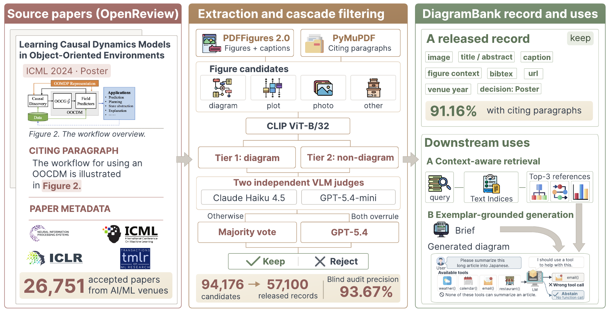

<div align="center">

# DiagramBank: Draw from the Great, Draw Your Best

[](https://arxiv.org/abs/2604.20857)
[](https://huggingface.co/datasets/ghzlmc/DiagramBank)
[](LICENSE)

</div>

DiagramBank is a reference resource of **57,100 scientific diagrams** from 26,751 accepted papers at ICLR, NeurIPS, ICML, and TMLR. Each diagram comes with its caption, the paper's title and abstract, and, for 91.16% of diagrams, the paragraphs that cite it. A blind human audit estimates 93.67% diagram-selection precision. Replacing PaperBanana's curated reference pool with DiagramBank raises the overall PaperBanana score on PaperBananaBench from 4.62 to 7.88.



## Quick start

**1. Install.**

```bash
conda env create --file environment.yml
conda activate DiagramBank
```

**2. Download** (about 53 GB by default).

```bash
export FIG_RAG_DIR=/path/to/data
python huggingface/download_diagrambank.py
```

The default download contains the images of all released diagrams, `data.jsonl`, the FAISS indices, and the DuckDB databases. `--subset all` adds the figures of rejected papers, `--no-core` downloads images only, and `--help` lists all options. Every file is checked against the SHA-256 values in [`huggingface/DiagramBank_remote_manifest.json`](huggingface/DiagramBank_remote_manifest.json) before extraction.

<details>
<summary>Folder layout after the default download</summary>

```
$FIG_RAG_DIR
├── data.jsonl
├── faiss
│   ├── abstract_index/   index.faiss, index.pkl
│   ├── caption_index/    index.faiss, index.pkl
│   ├── title_index/      index.faiss, index.pkl
│   └── research.db       DuckDB database (table Data, 57,100 records)
└── OpenReview
    ├── ICLR/     figures/2017 … 2026, research.db
    ├── ICML/     figures/2023 … 2025, research.db
    ├── NeurIPS/  figures/2021, 2022, 2024, 2025, research.db
    └── TMLR/     figures/2022 … 2026, research.db
```

Each FAISS index holds one `text-embedding-3-large` vector per diagram for the title, abstract, or caption, with the full record as metadata.

</details>

**3. Load the records.**

```python
import json
import os

FIG_RAG_DIR = os.environ["FIG_RAG_DIR"]
with open(os.path.join(FIG_RAG_DIR, "data.jsonl"), encoding="utf-8") as f:
    records = [json.loads(line) for line in f]

# DiagramBank-Core: the two filtering paths on which both VLM judges label the figure a diagram
core = [r for r in records if r["cascade_path"] in {"t1_unanimous", "t2_vlm_consensus_gpt_confirmed"}]
print(len(records), len(core))  # 57100 51590

record = core[0]
print(record["title"], record["figure_caption"])
print(os.path.join(FIG_RAG_DIR, record["figure_path"]))  # the diagram image
```

**4. Retrieve reference diagrams.** Queries are embedded with OpenAI's `text-embedding-3-large`, so set `OPENAI_API_KEY` (at most about $0.13 per 1,000 queries). `hierarchical_retrieval()` narrows the candidates by title (`t1`), then by abstract (`t2`), and returns the top `k` diagrams by caption.

```python
import os

from langchain_community.vectorstores import FAISS
from langchain_openai import OpenAIEmbeddings

FIG_RAG_DIR = os.environ["FIG_RAG_DIR"]
embeddings = OpenAIEmbeddings(model="text-embedding-3-large")
title_index, abstract_index, caption_index = (
    FAISS.load_local(os.path.join(FIG_RAG_DIR, "faiss", name), embeddings, allow_dangerous_deserialization=True)
    for name in ("title_index", "abstract_index", "caption_index")
)


def hierarchical_retrieval(title, abstract, caption, t1=100, t2=10, k=3):
    title_ids = {doc.metadata["id"] for doc in title_index.similarity_search(title, k=t1)}
    abstract_docs = abstract_index.similarity_search(
        abstract, k=t2, filter=lambda m: m["id"] in title_ids, fetch_k=len(title_ids) * 100)
    abstract_ids = {doc.metadata["id"] for doc in abstract_docs}
    return caption_index.similarity_search(
        caption, k=k, filter=lambda m: m["id"] in abstract_ids, fetch_k=len(abstract_ids) * 1000)
```

```python
results = hierarchical_retrieval(
    title="Transformers for image recognition",
    abstract="This paper proposes a new attention mechanism for vision tasks.",
    caption="Figure 1: The architecture of the Vision Transformer.",
    t1=1000, t2=100, k=5,
)
for rank, doc in enumerate(results, 1):
    print(f"Rank {rank}: {doc.metadata['title']}")
    print(f"  {os.path.join(FIG_RAG_DIR, doc.metadata['figure_path'])}")
```

## Dataset

| Venue | Years | Accepted papers | Diagrams |
|---|---|---:|---:|
| ICLR | 2017–2026 | 9,466 | 20,516 |
| NeurIPS | 2021–2022, 2024–2025 | 9,802 | 19,655 |
| ICML | 2023–2025 | 5,148 | 11,267 |
| TMLR | 2022–2026 | 2,335 | 5,662 |
| **Total** | | **26,751** | **57,100** |

- **Text per diagram:** caption, paper title, and abstract; citing paragraphs for 52,052 diagrams (91.16%).
- **Selection:** CLIP routing, two VLM judges (Claude Haiku 4.5, GPT-5.4-mini), and GPT-5.4 when both judges disagree with CLIP.
- **Precision:** 93.67% [90.11, 97.22] from a blind audit of 500 records; 95.2% on DiagramBank-Core (51,590 records).

Record fields are described in [docs/schema.md](docs/schema.md); construction, filtering paths, scope, and intended use in [DATASET_CARD.md](DATASET_CARD.md).

## Reproducing the paper

| Paper section | Code and artifacts |
|---|---|
| Data Collection | [`reproduce/`](reproduce/README.md): OpenReview collection, figure and caption extraction, citing-paragraph extraction, CLIP classification |
| Data Filtering | [`cascade/`](cascade/): routing, VLM judges, voting, and the saved votes for all 94,176 candidates |
| Record Fields and Paper Groups | [`release_supplement/`](release_supplement/): `cascade_labels.jsonl`, `paper_groups.jsonl`; [`tools/`](tools/): release export |
| Audit of Released Diagrams | [`experiments/final_release_audit/`](experiments/final_release_audit/) |
| Diagram–Text Alignment | [`experiments/context_review_50/`](experiments/context_review_50/) |
| Retrieval Evaluation, including the different-paper control | [`experiments/retrieval_ablation/`](experiments/retrieval_ablation/) |
| Same-paper control | [`experiments/same_paper_context_swap/`](experiments/same_paper_context_swap/) |
| PaperBananaBench Setup | [`experiments/paperbananabench/`](experiments/paperbananabench/): reference-pool protocol |
| Blind Human Evaluation | [`experiments/human_study/`](experiments/human_study/) |

To check that the saved votes reproduce the 57,100 released records exactly:

```bash
python cascade/finalize.py --output-dir <dir> --verify-release-db $FIG_RAG_DIR/faiss/research.db
```

## Citation

```bibtex
@article{yue2026diagrambank,
  title={DiagramBank: Draw from the Great, Draw Your Best},
  author={Yue, Ling and Wang, Jiaying and Lu, Zhexi and Zhu, Mingzhi and Zhang, Tingwen and Xu, Zhen and Pan, Shaowu},
  journal={arXiv preprint arXiv:2604.20857},
  year={2026}
}
```

Please also cite the source papers of diagrams you use directly; every record carries its source URL, and all but the ICML 2023 records carry a BibTeX entry.

## License

The code is released under the [MIT License](LICENSE). Diagrams remain subject to the terms of their source papers; see [DATASET_CARD.md](DATASET_CARD.md) for attribution and intended use.
